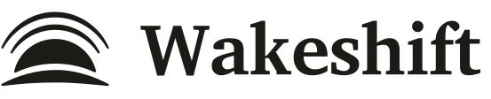

<h1 align="center">
  <a href="https://wakeshift.ai">
    <picture>
      <source media="(prefers-color-scheme: dark)" srcset="docs/images/wakeshift-dark.svg">
      
    </picture>
  </a>
</h1>

<p align="center">Wakeshift lets an MCP server wake the AI agents that use it.<br>This is its server: run it yourself, or use the hosted service at <a href="https://wakeshift.ai">wakeshift.ai</a>.</p>

<p align="center">
  <a href="https://wakeshift.ai/docs">Docs</a> ·
  <a href="https://wakeshift.ai/docs/how-it-works">How it works</a> ·
  <a href="#try-it-with-your-agent">Try it</a> ·
  <a href="docs/self-hosting.md">Self-hosting</a> ·
  <a href="docs/harnesses.md">Agents</a>
</p>

<p align="center">
  <a href="LICENSE"></a>
  <a href="https://github.com/wakeshift/server/actions/workflows/ci.yml"></a>
</p>

[![How Wakeshift works. Your app is on the left: your MCP server with the Wakeshift SDK attached, where defineEvent names the event, call.subscribe() runs in your MCP tool and emit() runs from your backend. Their agent is on the right, Wakeshift in the middle. 1, subscribe: the agent calls your tool, which subscribes its conversation with Wakeshift. 2, emit: your backend emits the event to Wakeshift. 3, wake: Wakeshift wakes the subscribed conversation through the agent's own MCP Events, Wakeshift's plugin (installed once, only if the user agrees) or a background listener, and the event arrives marked as coming from your app.](docs/images/how-it-works.svg)](https://wakeshift.ai/docs/how-it-works)

Your MCP server has events: a build finished, a reply arrived, a job is done. MCP Events (SEP-3415) is the standard way to offer them, and few agents subscribe to it yet (opencode 2.4 does): Claude Code, Codex, Cursor and most others never hear about your event. This server closes that gap. Run it next to your MCP server and:

- **Clients that speak MCP Events get the standard.** The server holds each subscription and delivers every occurrence by webhook, poll or push (`events/stream`), with the per-client compatibility today's clients need ([docs/mcp-events.md](docs/mcp-events.md)).
- **Clients that don't are woken anyway.** Claude Code, Codex, Cursor, GitHub Copilot CLI, opencode, pi, Antigravity CLI, OpenClaw, Hermes Agent and others are woken in the conversation that subscribed, through a bridge built for each one ([docs/harnesses.md](docs/harnesses.md)).
- **Webhooks become events.** Point GitHub, Stripe, CI or any other webhook sender at a publish URL, and each POST reaches every subscribed agent, by push or by wake. You write no handler.

Your code is the same for every agent. The SDKs attach to the MCP server you already have.

## Try it with your agent

Webhooks (`apps/try`) is a small app on this server that gives you a webhook URL: each POST to it wakes the agent watching it. It needs Docker, and no code. (To see a wake without running anything, use the hosted one at https://try.wakeshift.ai.) In a clone of this repository:

```sh
sh deploy/webhooks-env.sh                        # once: writes .env with fresh keys and secrets
docker compose --profile webhooks up --build     # or both at once: make webhooks
```

1. Open http://localhost:8380 and choose **Get a link**.
2. Pick your agent on the link's page (Claude Code, Codex, Cursor, opencode and others) and run the command it shows, such as `claude mcp add --transport http webhooks http://localhost:8380/t/…/mcp`. Then ask the agent to watch for webhooks.
3. Post to the webhook URL the page shows:

   ```sh
   curl -X POST 'http://localhost:8380/in/…' -H 'Content-Type: application/json' -d '{"hello":"world"}'
   ```

   The agent wakes with what you posted, and the page shows the post arrive. (Without the `Content-Type`, curl sends a form, and the agent gets it as one.)

Claude Code is woken with nothing more to install (it runs a background wait). Codex and the other agents that need Wakeshift's connector need this server to serve it ([the connector and installs](docs/self-hosting.md#the-connector-and-installs)).

Everything listens on `127.0.0.1` only. `docker compose --profile webhooks down -v` stops it and removes its data. Plain `docker compose up` leaves Webhooks out. Its settings are in [self-hosting](docs/self-hosting.md#webhooks).

## Run it

### Prerequisites

- Git to clone this repository and `openssl` to generate the server secret.
- A running Docker engine with the Compose plugin. On macOS, [install and open Docker Desktop](https://docs.docker.com/desktop/setup/install/mac-install/) for your Mac's chip. Complete its first-run prompts and wait for the engine to start. On Linux, your user needs access to the Docker daemon: add it to the `docker` group, or the first command fails with permission denied. Run `docker compose version` and `docker info` before continuing. If Docker Desktop is running but its CLI is missing on macOS, open a new terminal or add `$HOME/.docker/bin` to PATH when using Docker Desktop's user CLI installation.
- Port 8370 free for Wakeshift. Compose also uses port 5439 for Postgres. See the override below if 5439 is in use.
- For the JavaScript example, Node.js 22.12 or later and npm. Check them with `node --version` and `npm --version`.
- To test a real wake, install one interactive harness (`claude` or `codex`) and have a way to authenticate. The user enters their Anthropic API key locally for Claude Code or completes `codex login` in a browser for Codex. Have the user handle sign-in and hook approval in their own terminal. Keep API keys out of chat and source control.
- Install Go 1.27 to build the Codex connector, render a local Claude Code marketplace, or run the console with `make run`. Check `go version` from the clone. The Codex installer also needs `curl` and `shasum` or `sha256sum`. The console also needs Node.js.

Clone this repository and run the following from the clone. Keep this terminal open so the server stays running.

```sh
git clone https://github.com/wakeshift/server.git
cd server
docker compose run --build --rm --no-deps --entrypoint /appkey server -app example
export WAKESHIFT_APPS='<the JSON after WAKESHIFT_APPS= in what it printed>'
export WAKESHIFT_SECRET_KEY=$(openssl rand -base64 48)
docker compose up --build
```

The first command makes your app's key and prints two lines:

- `WAKESHIFT_KEY=wst_…`: your app's private key. Put it in your MCP server's environment, with `WAKESHIFT_CORE=http://localhost:8370`, and keep it out of version control.
- `WAKESHIFT_APPS=[…]`: the app's public key, which registers it with the server.

`docker compose up` then starts Postgres 17 and the server at `http://localhost:8370`, both on this machine's loopback only. Postgres is published on `127.0.0.1:5439`; if that port is taken, `export WAKESHIFT_DB_PORT=5440` (or any free port) first. The server migrates the database at startup, and MCP Events push is on. To sign in to the console on your own machine, use `make run` instead ([self-hosting](docs/self-hosting.md#development-sign-in)); to run the server anywhere else, see [docs/self-hosting.md](docs/self-hosting.md).

To stop, press Ctrl-C; `docker compose down -v` then removes the database. Apps registered through `WAKESHIFT_APPS` work with the SDKs but don't appear in the console's app list, which shows only the apps people create there.

### 1. Attach the SDK

In a second terminal, create a directory for the JavaScript example or use your existing MCP server's project. The [Python](https://github.com/wakeshift/wakeshift-python) and [Go](https://github.com/wakeshift/wakeshift-go) SDKs are also available.

```sh
npm install @wakeshift/sdk @modelcontextprotocol/server zod
```

Save this example as `server.mjs`. Export the `WAKESHIFT_KEY` printed by `/appkey` and set `WAKESHIFT_CORE=http://localhost:8370` in the terminal that will launch your harness.

```js
import { McpServer } from "@modelcontextprotocol/server"
import { StdioServerTransport } from "@modelcontextprotocol/server/stdio"
import { Wakeshift } from "@wakeshift/sdk"
import { z } from "zod"

const server = new McpServer({ name: "my-server", version: "1.0.0" }) // or your existing one
const wake = new Wakeshift() // reads WAKESHIFT_KEY and WAKESHIFT_CORE from the environment

export const buildFinished = wake.defineEvent("build.finished", {
  description: "A CI build finished",
  args: z.object({ repo: z.string() }),
  payload: z.object({ status: z.string() }),
  public: true, // open to subscribe_events and to MCP Events clients
})

if (process.argv[2] === "emit") {
  await buildFinished.emit({ repo: "api" }, { status: "passed" })
} else {
  wake.attach(server)
  await server.connect(new StdioServerTransport())
}
```

`attach` answers `events/list`, `events/subscribe`, `events/poll` and `events/stream`, and adds a `subscribe_events` tool for agents whose clients don't speak MCP Events. Tools of your own can subscribe the conversation that called them too ([events](https://wakeshift.ai/docs/events)), and [who may subscribe](https://wakeshift.ai/docs/who-may-subscribe) covers `personal`, `authorize` and the default, where only your tools subscribe.

### 2. Point your webhooks at it

Make a publish URL for the event, and give it to the service that sends the webhooks:

```ts
const { url } = await buildFinished.createPublishUrl({ repo: "api" })
```

Each POST to `url` emits one occurrence, with the body as its payload. Or emit from your own code: `await buildFinished.emit({ repo: "api" }, { status: "passed" })`. [Publish URLs](https://wakeshift.ai/docs/publish-urls) covers signed senders (Svix and Standard Webhooks), retries and revoking.

### 3. Get push, and wake an agent

- **A client that speaks MCP Events** (Mastra, opencode 2.4 and later) subscribes to `build.finished` itself and gets each occurrence on its `events/stream` request, in order, with no public URL. A native subscription to a `public` event belongs to a user, so it needs your server's sign-in (`attach`'s `identify`); without sign-in, a tool of yours hands the client a one-time voucher instead ([who may subscribe](https://wakeshift.ai/docs/who-may-subscribe)).
- **Claude Code** can wake through a background Monitor. To test hook-based wakes, render a [marketplace for your server](docs/self-hosting.md#the-connector-and-installs), add its local path with `claude plugin marketplace add /absolute/path/to/agent-plugins`, and install with `claude plugin install wakeshift@wakeshift`. Register the example with `claude mcp add --scope user example -- node /absolute/path/to/server.mjs`. Open an interactive `claude` session.
- **Codex** needs a connector that trusts this server. Follow [the connector build and Compose volume steps](docs/self-hosting.md#the-connector-and-installs), then download the local installer with `curl --fail --silent --show-error http://localhost:8370/install/codex.sh -o install-codex.sh` and run `sh install-codex.sh`. Register the example with `codex mcp add example -- node /absolute/path/to/server.mjs`. Open an interactive session with plain `codex` and approve the Wakeshift hooks when prompted. Idle wakes need Codex’s background server. Put any configuration overrides in `config.toml` and launch without `-c` or `--no-daemon`. If you use a throwaway `CODEX_HOME` on macOS, choose a short absolute path so Wakeshift can connect to the Codex control socket.
- For other agents, see [docs/harnesses.md](docs/harnesses.md).

In Claude Code or Codex, ask: “Use the example MCP server's subscribe_events tool to watch build.finished for repo api. Then stop and wait. Do not poll.” Confirm the subscription succeeded and wait for the session to become idle. From a separate terminal with the same app key and core URL, run `node /absolute/path/to/server.mjs emit`. The idle conversation should wake and receive the event. Test one harness at a time so each wake is easy to verify.

Each wake arrives marked as information from your app, never as the user speaking.

## Which agents it wakes

| Agent | How it's woken | What the user installs |
| --- | --- | --- |
| Claude Code | Wakeshift's plugin (hooks that wake an idle session), or a background Monitor the agent starts | Nothing, or the plugin |
| Codex | A hook that starts a per-thread connector, which starts a turn through Codex's app server | The plugin, once |
| Cursor, GitHub Copilot CLI, Antigravity CLI | A background command the agent starts, which ends when an event arrives | Nothing (hooks are optional) |
| opencode | Wakeshift's plugin, or MCP Events push from opencode 2.4 (its default install is still 1.x, which has none) | The plugin, once, or nothing on 2.4 and later |
| pi | Wakeshift's extension | The extension, once |
| OpenClaw, Hermes Agent | Wakeshift's plugin, which starts a run in the same chat; or their own MCP Events webhooks, which start a new run | The plugin, once, or nothing |
| Claude Cowork | A background Monitor inside the task | Nothing |
| ChatGPT (Work chats), Mastra, TanStack AI, Vercel AI SDK | Their own MCP Events support | Nothing |

[docs/harnesses.md](docs/harnesses.md) has every harness, the bridge for each, and the versions tested. To reproduce the matrix with real agents on your machine, see [bench/README.md](bench/README.md).

## SDKs and plugins

Everything an app or an agent's machine runs is open source too, under the same license:

- **SDKs:** [TypeScript](https://github.com/wakeshift/wakeshift-node) (`@wakeshift/sdk`), [Python](https://github.com/wakeshift/wakeshift-python) (`wakeshift`), [Go](https://github.com/wakeshift/wakeshift-go). Any other language works over the [HTTP API](https://wakeshift.ai/docs/http-api).
- **The connector and the bridges:** [wakeshift/connectors](https://github.com/wakeshift/connectors): the `wakeshift` program with its hooks for each harness, the OpenClaw plugin, the npm packages for opencode, pi and Cursor, and the developers' CLI, `@wakeshift/cli`.
- **Plugins:** [wakeshift/agent-plugins](https://github.com/wakeshift/agent-plugins) (Claude Code, Codex, Copilot CLI, Cursor), [wakeshift/antigravity-plugin](https://github.com/wakeshift/antigravity-plugin), [wakeshift/hermes-plugin](https://github.com/wakeshift/hermes-plugin).
- **Example apps:** [wakeshift/apps](https://github.com/wakeshift/apps): Agent Chat, Webhooks, the games, Slackline.

The published plugins trust `https://app.wakeshift.ai`. [Self-hosting](docs/self-hosting.md#point-the-sdks-cli-and-plugins-at-your-server) says how to point each one at your server.

## Or use the hosted service

[wakeshift.ai](https://wakeshift.ai) runs this server for you: no database, no scaling, no certificates, and the published plugins already trust it. Your code is the same either way; only `WAKESHIFT_CORE` changes.

## Docs

- [docs/self-hosting.md](docs/self-hosting.md): settings, sign-in, Postgres, proxies and push in production.
- [docs/mcp-events.md](docs/mcp-events.md): what the server implements of SEP-3415, and where it deviates.
- [docs/harnesses.md](docs/harnesses.md): how each agent is woken.
- [How it works](https://wakeshift.ai/docs/how-it-works): how a subscription and a wake flow between your app, the server and the agent.
- [bench/README.md](bench/README.md): the harness runner, to reproduce the matrix with real agents.
- [docs/codebase.md](docs/codebase.md) and [AGENTS.md](AGENTS.md): where things are, and the rules for changing them.
- [wakeshift.ai/docs](https://wakeshift.ai/docs): the developer documentation (SDKs, events, publish URLs, the HTTP API). `site/docs/` is that site's source: its links are site paths and some of it is template placeholders, which don't render on GitHub, so read it there.

## Contributing and security

Issues and pull requests are welcome; see [CONTRIBUTING](CONTRIBUTING.md). Commits are signed off under the Developer Certificate of Origin. Report a security problem privately, not in an issue: see [SECURITY](SECURITY.md).

## License

Apache License 2.0; see [LICENSE](LICENSE) and [NOTICE](NOTICE). The Wakeshift name and logos aren't licensed: see [TRADEMARKS](TRADEMARKS.md).
